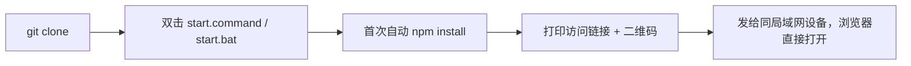
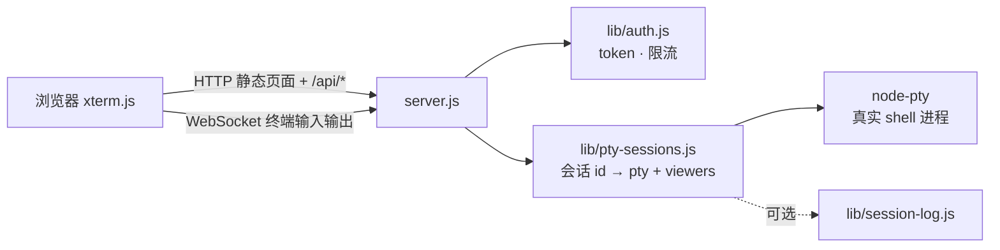
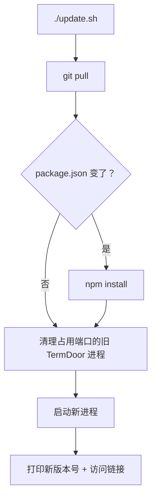

# TermDoor

> 浏览器里的终端之门

网页终端：浏览器打开一个网页，就能看到并操作这台电脑上一个**完整、可交互**的终端（`vim`/`top`/`ssh` 等全屏程序都能正常用，跟本地开一个真终端窗口体验一致）。适合"在另一台电脑或手机上，临时操作一下这台机器"的场景。默认只面向局域网；要跨网络访问见[远程访问](#远程访问跨网络)，**务必先读那一节的安全要求**。

## 目录

- [快速开始](#快速开始)
- [控制面板](#控制面板推荐日常入口)
- [架构设计](#架构设计)
- [功能与解决的问题](#功能与解决的问题)
- [更新流程](#更新流程)
- [权限与访问控制](#权限与访问控制)
- [开机自启](#开机自启可选)
- [远程访问（跨网络）](#远程访问跨网络)
- [界面与 ZhaoUI](#界面与-zhaoui)
- [环境变量](#环境变量)
- [安全须知](#安全须知)
- [已知问题](#已知问题)

## 快速开始

**前提**：装好 [Node.js](https://nodejs.org/)（18+）。

```bash
git clone https://github.com/zhaosay/termdoor.git
cd termdoor
```

| 操作 | macOS | Windows |
| --- | --- | --- |
| 启动 | 双击 `start.command` | 双击 `start.bat` |
| 停止 | 双击 `stop.command` | 双击 `stop.bat` |
| 日常控制面板（推荐） | 双击 `webcli.command` | 双击 `webcli.bat`，见下方[控制面板](#控制面板推荐日常入口) |
| 端口被占用 | 已自动清理，见[已知问题](#已知问题) | 同左 |



启动成功后终端会打印：

```
[termdoor] open: http://<这台电脑名>.local:3050/?token=xxxxxxxxxxxxxxxx
```

把这个完整链接发给同局域网内想连接的设备，浏览器直接打开即可——**对方不需要装任何东西**。也可以在页面顶部点"复制链接"按钮拿到当前地址，或者手机直接扫启动时打印的二维码。

> Token 每台电脑各自生成，存在项目目录上一级的 `../data/webcli/token.txt`，不进 git；只要不删这个文件，重启服务链接不变。默认端口 `3050`，临时换一次用 `PROJECT_PORT=8080 ./start.sh`；想固定长期换端口用 `./port.sh set 8080`（或控制面板选 `p`），重启后生效，详见[修改端口](#修改端口)。

## 控制面板（推荐日常入口）

不想记一堆脚本名字，双击 `webcli.command`（macOS）或跑 `./webcli.sh`；Windows 双击 `webcli.bat`，菜单结构完全一样。是个选数字的菜单：

```
  状态   ● 运行中 (端口 3050)
  链接   http://xxx.local:3050/?token=xxxxxxxx
  二次验证 关   会话记录 关

  1  启动 / 重启          5  二次验证开关
  2  停止                 6  重新生成 token
  3  更新代码并重启        7  会话记录开关
  4  显示访问链接和二维码   8  查看日志
                          9  安装全局 webcli 命令   p  修改监听端口
                          u  卸载（删除所有数据和代码）
```

选 `9` 装成全局命令后，任何目录敲 `webcli` 都能呼出这个面板，`webcli 3` 直接更新重启。下面各节讲的都是这个菜单背后对应的脚本，想直接用命令行操作也可以。

**卸载**：`./uninstall.sh`（或 `uninstall.bat`，或面板选 `u`）——停止服务、删掉开机自启项和全局命令、删掉运行时数据（token/日志/证书），最后连项目代码目录本身一起删掉。不可撤销，需要手动输入大写 `DELETE` 确认；如果项目目录里有还没提交的改动，会先警告一遍。只想清空数据、保留代码以后还能用的话，手动删 `../data/webcli/` 这一个目录就够了，不用跑这个脚本。

## 架构设计

| 层 | 文件 | 作用 |
| --- | --- | --- |
| 入口 | `server.js` | 建 HTTP/WebSocket server，接上路由和会话管理，可选加载 TLS 证书 |
| 配置 | `lib/config.js` | 端口、数据目录、各类超时/保留期常量，均可用环境变量覆盖 |
| 鉴权 | `lib/auth.js` | token / 二次验证密钥校验、WebSocket 同源校验、按 IP 限流锁定 |
| 会话管理 | `lib/pty-sessions.js` | 每个会话 id 对应一个真实 shell 进程 + 一组正在看它的连接（`viewers`），支撑多设备同时挂载、断线宽限期、输出缓冲回放 |
| HTTP 路由 | `lib/routes.js` | 静态文件 + `/api/name`、`/api/version`、`/api/connections`、`/api/auth-status` |
| 会话记录 | `lib/session-log.js` | 可选把终端输出落盘，按天数自动清理 |
| 二维码 / 图标 | `lib/qr.js`、`lib/icon.js` | 启动时终端打印二维码、PWA 图标 |
| 前端 | `public/` | `index.html` + `termdoor.css` + `app.js`，以及按功能拆出的 `upload.js`、`helpers.js`、`token.js`；[`xterm.js`](https://xtermjs.org/) 渲染终端，原生 WebSocket，无需构建；界面样式和组件来自 ZhaoUI（`public/vendor/`） |
| 运行时数据 | `../data/webcli/` | token / 电脑名 / 日志 / 证书 / 快捷命令，存在项目目录**外层**，不进 git、不跨机器共享 |



## 功能与解决的问题

| 功能 | 解决的问题 |
| --- | --- |
| 多设备同时查看同一终端 | 手机 + 笔记本想一起盯着同一个会话，尺寸自动取最小的那台 |
| 断线重连 + 输出回放 | wifi 抖动、笔记本合盖、切网络导致会话/画面丢失 |
| 二维码连接 | 手机上手动敲长链接太麻烦 |
| 端口占用自动清理 | 忘记关旧进程导致启动时 `EADDRINUSE` 报错 |
| 重新生成 token | 链接不小心截图分享/被人看到浏览器历史 |
| 可选会话记录 | 想事后查这台电脑被远程做了什么 |
| 可选二次验证 | token 单独泄露时再加一道独立防线 |
| 深色默认的主题 + 头部重新分组 | 界面拥挤，看不清当前谁连着；浅色、深色、跟随系统可在设置里切换 |
| 快捷命令条 | 常用命令每次都要重新敲；桌面端在标签页下面，手机端在底部、辅助键上面，离拇指近 |
| 浏览器记住 token | 每次打开不带 token 的地址都要手动输入；用对一次后自动记住，失效时自动回到输入框 |
| 版本号常驻显示 | 多台电脑各自更新，版本容易对不上，出问题不好排查 |
| 拖拽文件上传 | 传文件到远程机器不方便 |
| 持久化修改监听端口 | 默认端口和别的服务冲突，每次都用环境变量覆盖太麻烦 |

## 更新流程

```bash
./update.sh   # 或双击 update.command / update.bat，或控制面板选 3
```



全程不需要手动干预。多台电脑各自更新，页面头部（电脑名旁边）和启动日志都会显示当前版本号，方便确认这台机器到底跑的是哪个版本。

## 权限与访问控制

<table>
<tr><td width="200"><b>分享链接</b></td><td>

启动日志里 `open:` 那行就是完整链接，或页面右上角的"复制链接"图标按钮（旁边是二维码按钮）。链接里带 token，**泄露给谁就是把 shell 权限给了谁**——不要发到公开群里。

浏览器在服务端验证通过一次后，会把 token 存在这台设备的 `localStorage` 里，之后直接打开不带 token 的地址也能进。如果服务端换了 token（`./token.sh regen`），记住的旧 token 会在下次访问被拒后自动清掉，页面回到输入框。**共用的电脑上不要用这个功能的浏览器登录**，清掉站点数据即可忘记。

**本机免输入（默认关闭）**：在运行 TermDoor 的这台电脑上，想直接打开 `http://localhost:3050` 就进入、不输 token，可以开启 `local-autologin`：

```bash
echo -n 1 > ../data/webcli/local-autologin.txt   # 或环境变量 WEBCLI_LOCAL_AUTOLOGIN=1（优先于文件，=0 可强制关闭）
./restart.sh --bg                                # 重启后生效
```

只有**同时满足**这两条才会带 token 跳转：连接来自本机回环地址，并且请求的主机名是 `localhost` 或 `127.0.0.1`。从局域网、从隧道（远程端口）、或者把 `Host` 伪造成别的域名，都不会跳转。如果开启了二次验证，跳转之后仍然要输密钥。**代价**：这台电脑上的任何本地用户或进程打开这个地址都能直接进，所以多人共用的电脑不要开。

</td></tr>
<tr><td><b>二次验证</b><br><sub>默认关闭</sub></td><td>

```bash
./auth.sh on|off|status
```

除了链接里的 token，再要求单独输入一把密钥（不放在 URL 里，不容易随链接一起泄露）。立即生效，不打断正在跑的终端。

`off` 只关闭开关，**密钥文件会保留**：如果配了[远程端口](#远程端口给隧道用)，那个端口永远要求这把密钥，不受开关影响。`./auth.sh status` 在开关关闭时也会显示它。

</td></tr>
<tr><td><b>重新生成 token</b></td><td>

```bash
./token.sh regen|status
```

怀疑链接泄露了就换一把新的。`regen` 会**立即重启服务**，把当前所有连接（不管是谁）强制踢掉，旧链接全部失效。

</td></tr>
<tr><td><b>会话记录</b><br><sub>默认关闭</sub></td><td>

```bash
./log.sh on|off|status|list
```

只记屏幕输出、不记按键（`sudo` 密码本来就不回显，天然不会被记下来）；但 `cat` 过的文件内容会原样进日志，把日志目录当敏感文件对待。默认保留 7 天，`less -R <文件>` 查看效果最接近原始终端。

</td></tr>
<tr><td id="修改端口"><b>修改端口</b><br><sub>默认 3050</sub></td><td>

```bash
./port.sh set 8080|status
```

写到 `../data/webcli/port.txt`，重启服务后生效（面板选 `1`，或 `./restart.sh --bg`）。环境变量 `PROJECT_PORT` 优先级更高，适合一次性临时换端口，不会覆盖这里保存的设置。

</td></tr>
<tr><td><b>HTTPS</b><br><sub>默认关闭</sub></td><td>

```bash
WEBCLI_TLS=1 ./start.sh
```

首次启动自动生成自签名证书，浏览器会警告一次"不受信任"，点继续即可。剪贴板、PWA、Service Worker 都要求安全上下文，只有开了这个才完全好用。

</td></tr>
</table>

## 开机自启（可选）

| | macOS | Windows |
| --- | --- | --- |
| 启用 | `launchctl load ~/Library/LaunchAgents/com.webcli.server.plist`<br><sub>模板见 `contrib/com.webcli.server.plist`，先替换里面的路径占位符</sub> | `schtasks /create /tn "webcli" /tr "C:\path\to\webcli\start.bat" /sc onlogon` |
| 禁用 | `launchctl unload ~/Library/LaunchAgents/com.webcli.server.plist` | `schtasks /delete /tn "webcli" /f` |

## 线上设备中心（可选）

本地端仍可独立在局域网使用，不需要账号或服务器。开启线上连接后，可以在中心网站登录，查看自己的设备并进入终端。

中心地址由部署者提供，例如 `https://center.example.com`（示例地址，请替换）。账号由中心管理员创建，无公开注册。

**开发者自建：** 使用自己的服务器和域名，按[中文自建教程](center/SELF_HOSTING.zh-CN.md)部署中心。服务端域名通过部署配置设置，每台电脑在「设置 → 线上连接」填写中心地址。项目不提供默认公共中心，也不会自动接入作者的服务器。

### 接入一台电脑

1. 在中心网站登录，点击「接入新设备」，取得一个 10 分钟有效、只能使用一次的绑定码。
2. 在目标电脑更新到 **0.12.0 或更新版本**并重启 TermDoor，用该电脑自己的浏览器打开 `http://localhost:3050`（端口按实际配置），完成原有 token / 二次密钥验证。macOS / Linux 可运行 `./update.sh`，Windows 可运行 `update.bat`；更新会重启服务，请先保存终端中的工作。
3. 打开设置 →「线上连接」，填写中心地址和绑定码，点击「绑定并连接」。入口只在本机显示。
4. 本地端自动寻找 frpc；如果没有，会下载 frp 0.71.0，核对 GitHub 发布的 SHA-256 后安装到数据目录。支持 macOS、Linux、Windows 的 x64 / arm64；Windows 需要系统自带的 `tar`。
5. 等中心列表显示「在线」后，点击「打开终端」。浏览器不需要安装 frp。

如果没有「线上连接」入口，先确认页面版本至少为 0.12.0，再刷新页面，并确认访问的是目标电脑的 `localhost` 主端口。从局域网 IP、远程端口或中心代理页面访问时，此管理入口会隐藏。若自动下载 frpc 失败，可安装 frp 0.71.0，并在启动 TermDoor 前设置 `WEBCLI_FRPC_PATH` 为 frpc 可执行文件的绝对路径。

本地端通过 HTTPS/WSS 的 443 端口连接中心，使用独立设备凭证，不使用手工 frp 配置中的共享令牌。线上专用终端端口动态分配、只监听本机回环地址，始终要求第二把密钥；不会改动原有主端口、远程端口或 `frpc.toml`。证书使用 Node 内置可信 CA 校验。

「断开线上连接」会停止本地托管的 frpc，删除本地线上配置；局域网继续可用。中心的「解绑」会撤销凭证，并立即断开该设备的线上终端连接。设备必须重新生成绑定码才能接入。设备最近心跳有效且终端隧道鉴权检查成功，才显示在线。

运行时新增文件保存在 `../data/webcli/`：`online.json`、`online-frpc.toml`、`online-ca.pem`、`online-frpc*.log` 和 `bin/frpc`，都不进入仓库。`online.json` 含设备密钥，请作为敏感文件保管。可用 `WEBCLI_FRPC_PATH` 指定已有 frpc 的绝对路径。

电脑开机后自动上线，需要让 TermDoor 开机自启；本地端会随服务启动恢复线上连接。macOS 可使用现有 launchd 模板，Windows 使用现有登录计划任务。

中心端部署、账号和运维说明见 [center/README.md](center/README.md)。

## 远程访问（跨网络）

TermDoor 本身只负责"这台电脑上的网页终端"。要从别的网络访问，需要自己加一层转发，下面是三种做法。**这些步骤里的域名、IP、令牌都是占位符，换成你自己的；配置文件和令牌不要提交进仓库。**

### 先满足这些，再暴露到公网

终端能执行任意命令，暴露出去等于把这台电脑的 shell 交给能打开页面的人。

1. **要有二次验证**：除了链接里的 token，还要一把不在 URL 里的独立密钥（`./auth.sh status` 查看，`./auth.sh on` 会换新密钥）。用 frp 或其他隧道时，推荐配[远程端口](#远程端口给隧道用)：隧道走远程端口，**永远要密钥**；你自己在本机和局域网用主端口，可以不要密钥。
2. **用 HTTPS**。明文 HTTP 下 token、密钥和终端里的所有内容都能被中间人看到。优先用下面的 Cloudflare Tunnel 或 nginx 反向代理，别直接用 `http://<IP>:<端口>`。
3. **知道代理带来的一个副作用**：经过 frp、nginx、隧道转发后，TermDoor 看到的来访 IP 都是 `127.0.0.1`，"同一 IP 失败 10 次锁 5 分钟"在隧道这一路上变成"任何人试错 10 次，这一路上的所有人被锁 5 分钟"。配了[远程端口](#远程端口给隧道用)后，失败次数**按端口分开计数**，隧道那一路被锁不会影响你在本机和局域网用主端口；但隧道这一路本身仍然会被别人故意输错而锁住，目前没有读取 `X-Forwarded-For` 的选项。二次验证加 HTTPS 之外，如果前面有 nginx，建议在 nginx 层再做一层限流或访问控制。
4. frp 服务端的令牌要足够长且随机（例如 `openssl rand -hex 24`），它是 frp 控制端口的唯一保护。控制端口一旦对公网开放，会被扫描器持续尝试登录。

### 远程端口（给隧道用）

默认只有一个端口（`3050`，监听 `0.0.0.0`）。如果你想让自己在本机和局域网里免二次密钥，同时让隧道那一路永远要密钥，可以配一个**远程端口**：

```bash
echo -n 3051 > ../data/webcli/remote-port.txt   # 持久配置；也可以用环境变量 WEBCLI_REMOTE_PORT=3051 临时指定
./restart.sh --bg                               # 重启后生效（会结束正在运行的终端会话）
```

| | 主端口（默认 3050） | 远程端口（比如 3051） |
|---|---|---|
| 监听 | `0.0.0.0`，局域网可访问 | 只监听 `127.0.0.1`，局域网访问不到 |
| 二次密钥 | 跟随 `./auth.sh on/off` | **永远要求**；密钥文件不存在时一律拒绝，不会放行 |
| 失败 10 次锁 5 分钟 | 单独计数 | 单独计数，不影响主端口 |
| 谁用 | 你自己、局域网设备 | 只给 frpc、nginx 这类隧道或代理转发 |

区分两个端口靠的是"请求进来的本地端口"，这是内核给的，客户端伪造不了，不像 `Host` 头那样可以被随意改写。没配远程端口时，行为和以前完全一样。

下面 frp 的例子把 `localPort` 指向远程端口。

### 做法一：Cloudflare Tunnel（不用开端口，自带 HTTPS）

本机主动向外连 Cloudflare，不需要公网 IP、不需要在服务器上装任何东西，也不需要开防火墙端口。按 Cloudflare 官方文档创建隧道，把你的域名（例如 `term.example.com`）指到 `http://localhost:3050`。**这一做法我没有在本项目里实际验证过**，请以 [Cloudflare Tunnel 文档](https://developers.cloudflare.com/cloudflare-one/connections/connect-networks/)为准；它同样适用上面的二次验证和限流提醒。

### 做法二：frp（有自己的公网服务器）

下面这套在 frp 0.71.0（服务端和客户端同版本）上实际验证过通路：本机的[远程端口](#远程端口给隧道用)映射到服务器的一个端口，从公网侧访问能打开登录页，并且要求 token 加二次密钥。

服务器 `frps.toml`：

```toml
bindPort = 7000
auth.method = "token"
auth.token = "<一串足够长的随机字符串>"

# 只允许客户端映射这个范围内的端口
allowPorts = [
  { start = 6000, end = 6100 }
]
```

本机 `frpc.toml`（权限设成 600，**不要提交**）：

```toml
serverAddr = "<你的服务器 IP 或域名>"
serverPort = 7000
auth.method = "token"
auth.token = "<和 frps 一致>"

[[proxies]]
name = "termdoor"
type = "tcp"
localIP = "127.0.0.1"
localPort = 3051      # TermDoor 的远程端口，不是主端口 3050
remotePort = 6050
```

**不想手写 `frpc.toml`，可以用页面保存**：在运行 TermDoor 的这台电脑上用 `localhost` 打开，右上角设置菜单里会出现「frp 配置」，填服务器地址、控制端口、令牌、服务器上的映射端口、代理名，点保存。它会在数据目录里生成 `../data/webcli/frpc.toml`（权限 600），然后你自己用 `frpc -c ../data/webcli/frpc.toml` 启动或重启 frpc，页面不会替你启动进程。

这个功能刻意做得很窄，因为它能改"隧道通向哪里"：

- **只有本机可用**：从局域网、从隧道（远程端口）、或把 `Host` 伪造成别的域名访问，都是 403，设置菜单里也不会出现入口。
- **配置由字段生成，不接受整段 TOML**：每个字段都严格校验（地址只能是主机名或 IPv4，端口 1 到 65535，令牌和代理名只允许少数字符），不合法就拒绝，什么都不写。否则请求里可以夹带额外的代理或插件，把磁盘或 shell 直接映射出去。
- **映射的本地端口固定为 TermDoor 的[远程端口](#远程端口给隧道用)**，页面不能改。没配远程端口时保存被禁用，避免把不要密钥的主端口暴露出去。
- **令牌只进不出**：保存后接口和页面都不会再返回令牌，令牌输入框留空表示保持不变；"清除配置"会连令牌一起删除文件。

- 云服务器的安全组/防火墙要放行 `7000` 和你用的映射端口（例如 `6050`）。**不要动你的 SSH 端口规则。**
- 这样得到的地址是 `http://<服务器 IP>:6050/`，**是明文 HTTP**。要 HTTPS，在服务器上再加一层 nginx（见做法三），并考虑让 frps 的映射端口只监听本机（frps 的 `proxyBindAddr`，请以你所用 frp 版本的文档为准），否则别人仍然可以绕过 nginx 直接访问明文端口。
- 如果域名走 Cloudflare 的橙云代理：Cloudflare 只代理固定的几个端口，非标准端口（比如 `6050`）要用灰云（仅 DNS）。具体端口列表以 Cloudflare 官方文档为准。
- 想让 frpc 开机自动连接，用 macOS 的 launchd 或 Linux 的 systemd 管理它，两者都不属于本项目。

### 做法三：nginx 反向代理 + HTTPS

在有公网地址的机器上，给你的域名配一个 HTTPS 站点，转发到 TermDoor（或 frp 映射出来的端口）。**必须带上 WebSocket 升级头和 `Host`**，TermDoor 的同源校验会拿浏览器的 `Origin` 和请求的 `Host` 比对：

```nginx
server {
    listen 443 ssl;
    server_name term.example.com;
    # ssl_certificate     /path/to/fullchain.pem;
    # ssl_certificate_key /path/to/privkey.pem;

    location / {
        proxy_pass http://127.0.0.1:6050;   # frp 映射出来的端口；本机直接转发就写远程端口（如 3051）
        proxy_http_version 1.1;
        proxy_set_header Upgrade $http_upgrade;
        proxy_set_header Connection "upgrade";
        proxy_set_header Host $host;
        proxy_read_timeout 3600s;
    }
}
```

这段 nginx 配置是通用示例，**没有在本项目里实际跑过**，上线前请自己用 `nginx -t` 检查，并先在测试域名上试。

## 界面与 ZhaoUI

界面样式和组件来自 ZhaoUI（作者的 UI 组件库，原生 HTML/CSS/JS，无框架），三个文件复制在 `public/vendor/`：`zhaoui.css`、`zhaoui.js`、`zhaoui-icons.js`。颜色、间距、圆角、字体都引用 ZhaoUI 的 `--zh-*` 变量，主题由 `<html>` 的 `data-mode`（`light`/`dark`）控制。

- ZhaoUI 仓库：[github.com/zhaosay/zhaoui](https://github.com/zhaosay/zhaoui)
- ZhaoUI 仓库里的 `dist/` 是构建产物、不提交到仓库：要更新这三个文件，先在 ZhaoUI 仓库里运行 `npm run build`，再从 `packages/ui/dist/` 复制 `zhaoui.min.css`、`zhaoui.min.js`、`zhaoui-icons.min.js`，分别改名为 `zhaoui.css`、`zhaoui.js`、`zhaoui-icons.js`。
- 更新这三个文件后，要把 `lib/routes.js` 里 service worker 的 `CACHE` 名字加一档，否则老客户端会一直用缓存里的旧文件。
- 许可证：本项目使用 [MIT 许可证](LICENSE)：可以自由使用、修改和分发，但需要保留版权声明和许可证文本（即署名引用）。ZhaoUI 同样是 MIT；它里面的图标来自 Lucide（ISC）和 Feather（MIT），这些声明保存在 [THIRD_PARTY_NOTICES.md](THIRD_PARTY_NOTICES.md)，复制或再分发 `public/vendor/` 里的文件时请一并保留。

## 环境变量

| 变量 | 默认 | 说明 |
| --- | --- | --- |
| `PROJECT_PORT` | `3050` | 监听端口，一次性临时覆盖（优先级高于 `./port.sh set` 保存的端口） |
| `WEBCLI_REMOTE_PORT` | 空 | 远程端口（给 frp 等隧道用，只监听 127.0.0.1，永远要二次密钥），优先级高于 `../data/webcli/remote-port.txt`，见[远程端口](#远程端口给隧道用) |
| `WEBCLI_LOCAL_AUTOLOGIN` | 空（关） | `1`：本机用 `localhost` 打开主端口时自动带 token 跳转；优先于 `../data/webcli/local-autologin.txt`，见[权限与访问控制](#权限与访问控制) |
| `WEBCLI_TLS` | `0` | `1` 启用自签名 HTTPS |
| `RECONNECT_GRACE_MS` | `86400000`（24 小时） | 断线后会话保留时长（毫秒） |
| `SCROLLBACK_BYTES` | `262144` | 重连回放的输出上限 |
| `LOG_RETENTION_DAYS` | `7` | 会话日志保留天数 |
| `WEBCLI_UPLOAD_DIR` | `~/webcli-uploads` | 拖拽上传的落地目录 |

## 安全须知

> 默认的信任模型是"局域网内部小工具"：默认没有 HTTPS（明文传输）；服务监听 `0.0.0.0`，VPN/热点共享等网络里也能连进来；没有账号体系，**谁有 token 谁就能跑任意命令**；默认无操作审计。已经做的防护：WebSocket/写接口同源校验、鉴权失败每 IP 10 次锁 5 分钟、`Referrer-Policy: no-referrer`、上传文件名剥离目录穿越、可选的二次验证密钥。**怀疑 token 泄露就 `./token.sh regen`。**
>
> **想放到公网，必须先满足[远程访问](#远程访问跨网络)里的安全要求**，不要只靠一个 token 就把终端暴露出去。

## 已知问题

- **端口被占用**：`start.sh`/`start.bat` 会自动清理"确认是 TermDoor 自己"的残留进程再启动；如果占用的是别的程序（或者是一个卡死、命令行特征对不上的旧 TermDoor 进程，脚本不敢确认就不会自动杀），会打印出占用者的进程信息（Windows 用 `tasklist`，macOS/Linux 用 `ps`）并问你要不要结束它、结束后自动重新启动；不结束的话会提示你换端口，全程不会误杀
- `node-pty` 的 prebuilt 二进制解压后偶尔丢失可执行位，`start.sh` 已用 `chmod +x` 兜底
- 首次监听端口时 macOS 可能弹防火墙提示，点允许即可
- **Windows 上中文乱码 / 窗口一闪而退**：`.bat` 脚本是 UTF-8 编码，如果系统控制台代码页不是 UTF-8（简体中文 Windows 默认是 GBK/936），cmd.exe 会用错误的代码页解析脚本里的中文，轻则显示乱码，重则把某个中文字节序列误判成 `(`/`)` 等特殊字符导致整个脚本语法出错、窗口直接关闭。已在所有 `.bat` 脚本开头加了 `chcp 65001`（切到 UTF-8 代码页）修复；如果拉取更新后还遇到，先确认本地 `.bat` 文件确实更新到了最新版本（`findstr chcp webcli.bat` 应该能看到这一行）
- **Windows 11 24H2+ 启动总提示端口被占用**：`restart.bat` 靠比对进程命令行来确认"这是不是 TermDoor 自己上次留下的进程"，原来用 `wmic` 查命令行，但 `wmic.exe` 在较新的 Windows 11 上默认被移除了，查不到就永远判断不出是不是自己的旧进程，导致旧进程从不会被清理、端口一直显示被占用。已改用系统自带的 PowerShell（`Get-CimInstance`）代替 `wmic`
